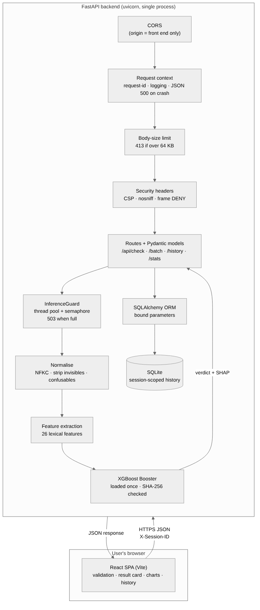
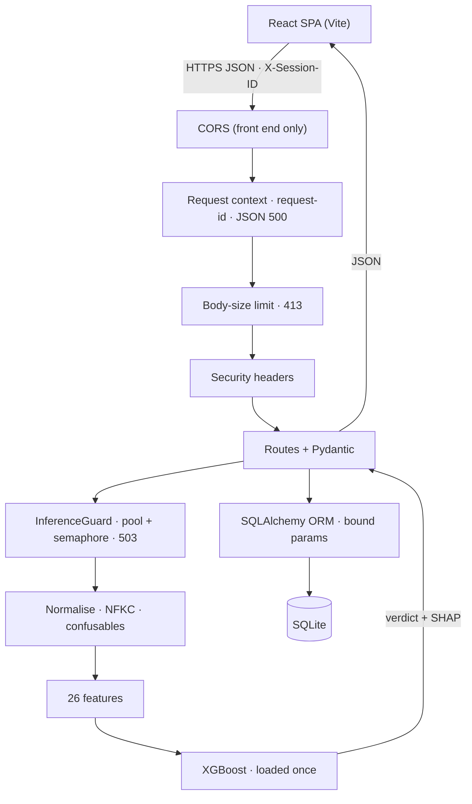
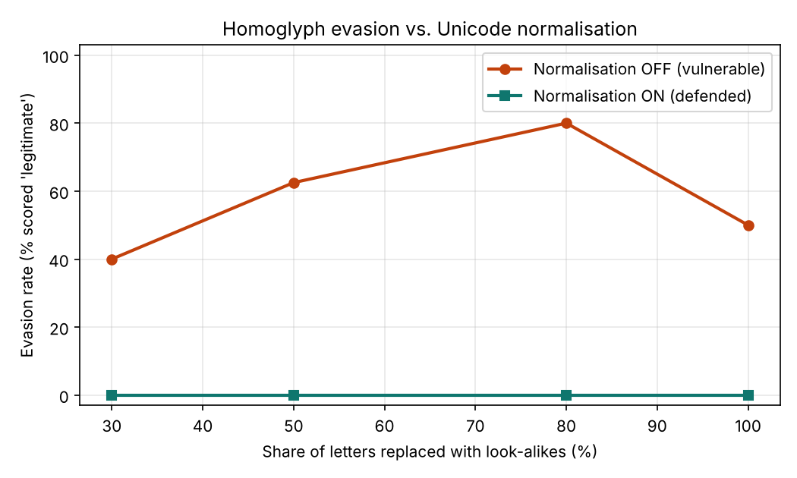

# PhishGuard — a secure web application for phishing-URL detection

PhishGuard wraps the machine-learning phishing-URL classifier from Assignment 2
in a full-stack web application: a React front end and a FastAPI back end, built
and hardened against the web-application and ML-specific risks in the unit
material.

A user pastes a web address; the back end extracts 26 lexical features, runs an
XGBoost model, and returns a verdict (**phishing** / **legitimate**), a
confidence score, the suspicious parts of the address, and the model features
that drove the decision. The URL is only ever treated as *text* — the server
never visits it.

---

## Contents

- [Quick start](#quick-start)
- [Architecture](#architecture)
- [Pinned dependency versions](#pinned-dependency-versions)
- [API](#api)
- [Security: defences marked for section 2.7](#security-defences-marked-for-section-27)
- [Security: advanced attack for section 2.8](#security-advanced-attack-for-section-28)
- [Threat model](#threat-model)
- [Running the security demonstrations](#running-the-security-demonstrations)
- [Testing](#testing)
- [Dependency audit](#dependency-audit)
- [References](#references)

---

## Quick start

Requirements on a clean machine:

- **Python 3.11+** (developed and tested on 3.13)
- **Node.js 20+** and npm (tested on Node 22 / npm 10.9)

The back end and front end run as two processes. Open two terminals.

### 1. Back end

```bash
cd backend
python -m venv .venv
source .venv/bin/activate          # Windows: .venv\Scripts\activate
pip install -r requirements.txt
cp .env.example .env               # optional; defaults are already secure
uvicorn app.main:app --port 8000 --no-server-header
```

The API is now at <http://localhost:8000>, with interactive docs at
<http://localhost:8000/docs>.

### 2. Front end

```bash
cd frontend
cp .env.example .env               # sets VITE_API_URL=http://localhost:8000
npm install
npm run dev
```

Open the URL Vite prints (default <http://localhost:5173>).

> The model file (`backend/models/phishguard_xgb.json`) ships with the project,
> so no training step is needed. Its SHA-256 is checked at start-up; if the file
> is altered the server refuses to start.

---

## Architecture



*(Source: [`docs/architecture.mmd`](docs/architecture.mmd). The same diagram in
Mermaid:)*



**Request flow and why the order matters.** Every request passes through the
middleware stack top-to-bottom. CORS is outermost so that *even error responses*
carry the right `Access-Control-Allow-Origin` header. The request-context layer
wraps everything in a `try/except` that turns any unhandled crash into a clean
JSON `500` with a request id (never a stack trace). The body-size limit rejects
oversized payloads before they are parsed, and the security-headers layer stamps
every response. Only then do the route handlers run, validating input with
Pydantic models before any work happens.

**Model is loaded once.** The XGBoost booster and its metadata are loaded a
single time at application start-up (FastAPI `lifespan`) and reused for every
request — not reloaded per call.

**Back end layout**

```
backend/
  app/
    main.py          FastAPI app, middleware, routes, exception handlers
    config.py        Pydantic-settings (env prefix PG_); all tunables
    schemas.py       Pydantic request/response models
    model.py         PhishingModel: hash check, features -> verdict + SHAP
    normalise.py     Unicode normalisation / confusable mapping
    guard.py         InferenceGuard: thread pool + semaphore admission control
    security.py      body-size + security-headers middleware, JSON error shape
    db.py            SQLAlchemy models and queries (ORM + demo insecure query)
    features/        lexical feature extraction (ported from Assignment 2)
  models/            phishguard_xgb.json + metadata + .sha256
  tests/             pytest suite (TestClient)
  requirements.txt
```

**Front end layout**

```
frontend/
  src/
    api/client.js        fetch wrapper, session id, timeouts, error parsing
    validation.js        client-side URL checks (usability only)
    pages/               Home, About, NotFound
    components/          UrlForm, ResultCard, ContributionChart,
                         HistoryChart, HistoryList, ErrorBoundary, Icons
    styles.css           single design-token colour scheme, responsive
```

---

## Pinned dependency versions

Every dependency is pinned to an exact version so the app builds identically on
a clean machine. Full lists: [`backend/requirements.txt`](backend/requirements.txt)
and [`frontend/package.json`](frontend/package.json).

| Back end | Version | | Front end | Version |
| --- | --- | --- | --- | --- |
| fastapi | 0.162.2 | | react / react-dom | 18.3.1 |
| starlette | 1.10.0 | | react-router-dom | 6.30.6 |
| uvicorn[standard] | 0.53.0 | | recharts | 2.15.0 |
| pydantic | 2.13.5 | | vite | 6.4.5 |
| pydantic-settings | 2.7.1 | | @vitejs/plugin-react | 4.7.0 |
| SQLAlchemy | 2.0.36 | | | |
| xgboost | 3.4.1 | | | |
| numpy | 2.5.3 | | | |
| tldextract | 5.4.0 | | | |

`scikit-learn` and `scipy` are **not** runtime dependencies: the model is served
as a raw XGBoost booster, which keeps the dependency surface (and attack surface)
small.

---

## API

Interactive documentation is generated automatically at `/docs` (Swagger UI) and
`/redoc`, from the Pydantic models and route definitions.

| Method | Path | Purpose |
| --- | --- | --- |
| `GET` | `/api/health` | Liveness + which model and config are loaded. |
| `POST` | `/api/check` | Check one URL. Saves to history if `X-Session-ID` is sent. |
| `POST` | `/api/check/batch` | Check up to 50 URLs in one request. |
| `GET` | `/api/history` | This session's past checks; `?search=` filters by substring. |
| `DELETE` | `/api/history` | Clear this session's history. |
| `GET` | `/api/stats` | Counts and average confidence for this session. |

Two genuinely different HTTP methods carry semantics: `POST` creates a check,
`DELETE` clears history, `GET` reads. Status codes are meaningful: `200`, `400`
(missing/invalid session id), `413` (body too large), `422` (validation),
`503` (server busy / timeout), `404` (unknown path).

**One error shape, everywhere.** Every error — validation, not-found, busy,
crash — returns the same JSON envelope and never leaks internals:

```json
{ "error": { "code": "validation_error", "message": "Enter a web address.",
             "details": [{ "field": "url", "problem": "Enter a web address." }] },
  "request_id": "a1b2c3d4e5f6" }
```

**Privacy by design.** History is scoped to a random `X-Session-ID` (UUID v4)
generated in the browser and kept in `sessionStorage`; it is not an account and
contains no personal data. There is no authentication because the app stores
nothing worth authenticating — each session can only ever see its own checks,
and that scoping is enforced server-side by a bound query parameter.

---

## Security: defences marked for section 2.7

Two defences are implemented and demonstrated by attacking the app first with
the defence **off**, then **on**. Scripts and measured results are in
[`security/`](security/).

### Defence 1 — Denial of Service via expensive requests (Advanced)

**Risk.** `/api/check/batch` runs the model once per URL, so a single large
batch is an *expensive request*. A burst of these can exhaust the server so that
ordinary single-URL checks from real users hang or fail (CPU/thread exhaustion,
OWASP API4:2023 *Unrestricted Resource Consumption*).

**Defence — `InferenceGuard` (admission control).** All model inference runs in
a bounded `ThreadPoolExecutor` fronted by an `asyncio.Semaphore` whose capacity
is `workers + queue`. The event loop is never blocked by inference. When every
slot is taken the server **rejects immediately** with `503` + `Retry-After`
instead of queueing without limit, and any single job exceeding the timeout is
abandoned with a `503`. Batch size is capped (50) and the body-size limit (64 KB)
bounds a request before it is even parsed — defence in depth.

**Measured result** (`python ../security/dos_attack.py`):

| | Defence OFF | Defence ON |
| --- | --- | --- |
| User single-check latency, idle | 8 ms | 7 ms |
| User single-check latency, under flood | **hung (all failed)** | **7 ms** |
| User checks failing during flood | 8 / 8 | 3 / 8 |
| Attacker requests shed with `503` | 0 | 14 |

With the defence off, the attacker's batches run inline and real users' checks
stall completely. With it on, user latency is unchanged and the excess attacker
load is shed gracefully as `503`s (the front end shows *"try again in N
seconds"*). Under an extreme flood a few user requests are also shed — a fast,
recoverable `503`, which is the intended graceful degradation, not a hang.

### Defence 2 — SQL injection (Intermediate)

**Risk.** The history search filters rows by a user-supplied term. If that term
were concatenated into SQL, a payload such as `' OR '1'='1` or a `UNION SELECT`
could break out of the intended query and read **other sessions'** rows
(OWASP A03:2021 *Injection*).

**Defence — parameterised ORM queries.** The real query uses the SQLAlchemy ORM:
the session filter and the search term are sent to SQLite as **bound
parameters** (`Check.url.contains(term, autoescape=True)`), never concatenated.
The database treats the payload as a literal string to search for, so it matches
nothing. A deliberately vulnerable f-string query is included **only** behind the
`PG_INSECURE_SQL_DEMO` flag to prove the contrast.

**Measured result** (`python ../security/sqli_attack.py`):

| Payload | Insecure build | Secure build (ORM) |
| --- | --- | --- |
| `harmless` (baseline) | attacker's own row | attacker's own row |
| `%' OR 1=1 -- ` | **victim rows leaked** | 0 rows |
| `%' UNION SELECT id FROM checks -- ` | **victim rows leaked** | 0 rows |

### Other hardening (defence in depth)

- **No HTML rendering of input.** React escapes all values; the checked URL and
  the 404 path are rendered as text, never as links or `dangerouslySetInnerHTML`.
  The API's CSP is `default-src 'none'`.
- **CORS** is restricted to the front-end origin only.
- **Secrets / config in environment variables** via `pydantic-settings`
  (prefix `PG_`); nothing sensitive is hard-coded.
- **Safe model loading:** the model is a JSON booster (not a pickle, so no
  arbitrary-code-execution on load) and its SHA-256 is verified at start-up.
- **Security headers** on every response: CSP, `X-Content-Type-Options`,
  `X-Frame-Options: DENY`, `Referrer-Policy`, and no-store caching for the API.

---

## Security: advanced attack for section 2.8

### Detection evasion via homoglyph substitution

**Attack.** The model scores a URL from its characters. An attacker replaces
Latin letters with visually identical characters from other Unicode blocks (a
Cyrillic `а` for `a`, a Greek `ο` for `o`). To a human the address is unchanged,
but the learned tokens (`paypal`, `login`, `secure`) no longer match, so
suspicious-word and brand features stop firing and the score drops below the 0.5
threshold. This is an adversarial-input attack on the model itself.

**Defence.** Before any feature is computed, `normalise.py` applies Unicode
**NFKC**, strips invisible/zero-width characters, decodes punycode hosts, and
maps known confusables back to their Latin equivalents. The model therefore
scores the canonical address.

**Measured result** (`python ../security/measure_evasion.py`) — the attacker picks
homoglyphs from its own public look-alike table, independent of the server's map:



| Letters replaced | Evasion rate, normalisation OFF | Evasion rate, normalisation ON |
| --- | --- | --- |
| 30% | 40.0% | 0.0% |
| 50% | 62.5% | 0.0% |
| 80% | **80.0%** | 0.0% |
| 100% | 50.0% | 0.0% |

Without normalisation, homoglyph variants evade detection up to 80% of the time;
with it, evasion falls to 0%. (At 100% substitution the evasion rate *drops*
even undefended, because an address containing no Latin letters is itself
anomalous — but relying on that is fragile, which is exactly why normalisation
is the right fix.)

---

## Threat model

**What we protect.** Availability of the checking service, integrity of the
model's verdict, and isolation of each session's history. The app holds no
accounts, passwords, or personal data by design, so there is little of
confidentiality value to steal — a deliberate risk-reduction choice.

**Who the attackers are.**

- *An anonymous internet user* who can send arbitrary HTTP requests to the API
  (the front end is not a trust boundary — it can be bypassed entirely).
- *A malicious submitter* who controls the URL string being checked and wants to
  evade detection.
- *A curious user* who wants to read another session's history.

We assume **no** trusted-insider or host-compromise attacker, and that TLS is
terminated by the deployment platform in production.

**Which section 2.7 risks apply, and how they are handled.**

| Risk | Applies? | Handling |
| --- | --- | --- |
| Injection (SQL) | **Yes** | Parameterised ORM queries (demonstrated). |
| Denial of Service / resource exhaustion | **Yes** | Admission control + size/batch caps (demonstrated). |
| Cross-site scripting (XSS) | **Yes** | React auto-escaping; strict CSP; no raw HTML sinks. |
| Injection via model file (unsafe deserialization) | **Yes** | JSON booster, not pickle; SHA-256 verified. |
| Sensitive-data exposure | Limited | No accounts/PII stored; errors reveal no internals. |
| Broken authentication | **No** | No auth surface exists; sessions are unprivileged and self-scoped. |
| CSRF | **No** | No cookies or ambient authority; requests are explicit JSON. |
| SSRF | **No** | The server never fetches the submitted URL. |

**Residual risk.** PhishGuard is a classifier, not a guarantee — a "legitimate"
result can be wrong, which the UI states plainly. The model can also be evaded
by attack styles outside the normalisation defence (e.g. brand-new domains with
no suspicious tokens); mitigating those is future work (e.g. reputation feeds).

---

## Running the security demonstrations

With dependencies installed (no server needs to be running — each script starts
the API itself in the two required configurations on a spare port):

```bash
cd backend && source .venv/bin/activate
python ../security/dos_attack.py
python ../security/sqli_attack.py
python ../security/measure_evasion.py      # also writes security/evasion_result.png
```

See [`security/README.md`](security/README.md) for details and the configuration
toggles (all default to the secure setting).

---

## Testing

```bash
cd backend && source .venv/bin/activate
python -m pytest
```

18 tests (`backend/tests/`) cover the happy path, validation and error shapes,
security headers, per-session isolation of history, the injection payload being
treated literally, the batch endpoint, and stats — all via FastAPI's
`TestClient` against a throwaway database.

---

## Dependency audit

```bash
pip-audit -r backend/requirements.txt     # -> No known vulnerabilities found
cd frontend && npm audit
```

- **Back end: 0 known vulnerabilities.** An initial audit flagged 14 advisories
  in `starlette` 0.41.3; we upgraded to `fastapi` 0.162.2 / `starlette` 1.10.0
  (which the full test suite confirms is compatible) to clear them.
- **Front end: 2 moderate advisories remain**, both in `react-router` and fixed
  only by the v7 **major** release. Neither is reachable here: the app does no
  server-side rendering (so the SSR-hydration advisory does not apply) and every
  navigation target is a hard-coded path (so the open-redirect advisory has no
  attacker-controlled input). Upgrading to v7 is noted as future work. The
  earlier `esbuild` dev-server advisory was cleared by moving to `vite` 6.

---

## Generative AI Use

Generative AI tools were used during development to assist with brainstorming, code review, debugging, and explanations of technical concepts. All of the recommended ideas generated suggestions were reviewed, discussed, tested, and modified by the team before being incorporated into the project. We were responsible for the final implementation, security decisions, testing, model integration, and understanding of the submitted work.

---

## References

Harvard (author–date) style.

FastAPI (2026) *FastAPI documentation*. Available at: https://fastapi.tiangolo.com
(Accessed: 8 November 2026).

Mozilla (2026) *Content Security Policy (CSP)*, *MDN Web Docs*. Available at:
https://developer.mozilla.org/en-US/docs/Web/HTTP/CSP (Accessed: 8 November 2026).

OWASP (2021) *OWASP Top 10:2021*. Available at: https://owasp.org/Top10/
(Accessed: 8 November 2026).

OWASP (2023) *OWASP API Security Top 10:2023*. Available at:
https://owasp.org/API-Security/editions/2023/en/0x11-t10/ (Accessed: 8 November 2026).

OWASP (2024) *SQL Injection Prevention Cheat Sheet*. Available at:
https://cheatsheetseries.owasp.org/cheatsheets/SQL_Injection_Prevention_Cheat_Sheet.html
(Accessed: 8 November 2026).

The Unicode Consortium (2023) *Unicode Technical Standard #39: Unicode Security
Mechanisms*. Available at: https://www.unicode.org/reports/tr39/ (Accessed: 8 November 2026).

Lundberg, S.M. and Lee, S.-I. (2017) 'A unified approach to interpreting model
predictions', *Advances in Neural Information Processing Systems*, 30, pp. 4765–4774.

Chen, T. and Guestrin, C. (2016) 'XGBoost: A scalable tree boosting system',
*Proceedings of the 22nd ACM SIGKDD International Conference on Knowledge
Discovery and Data Mining*, pp. 785–794.
